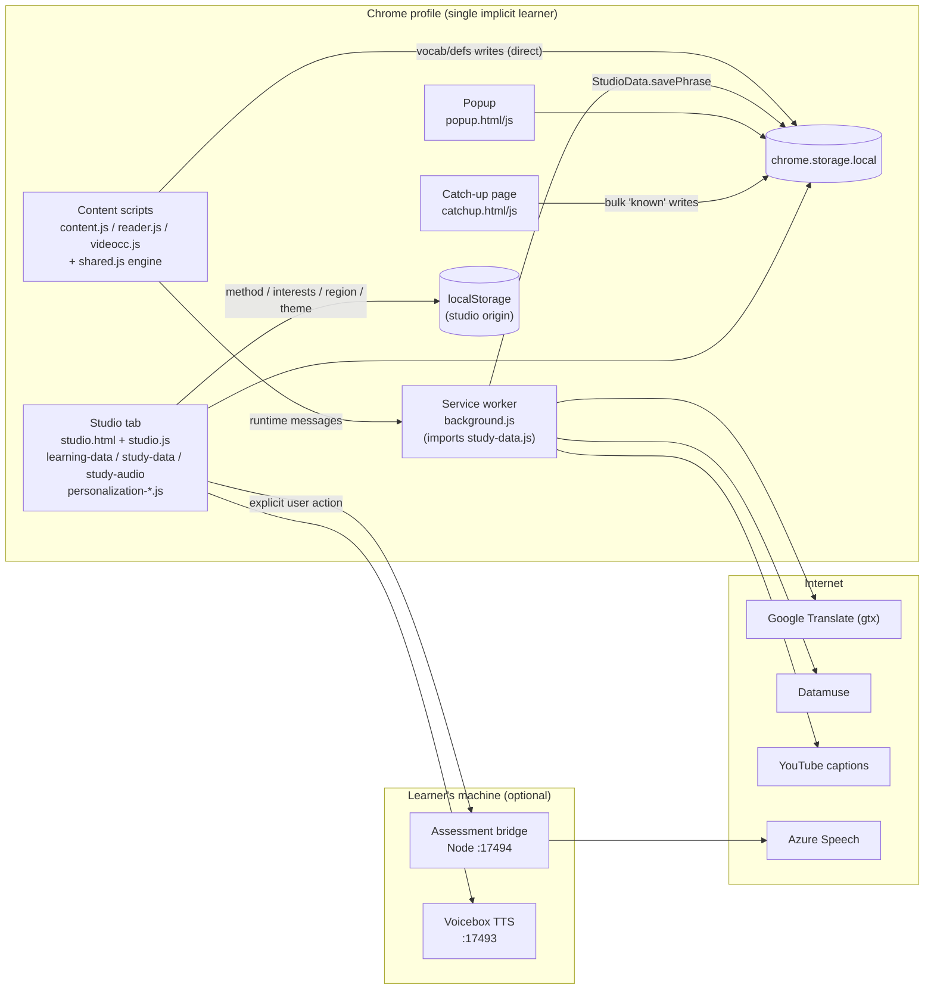
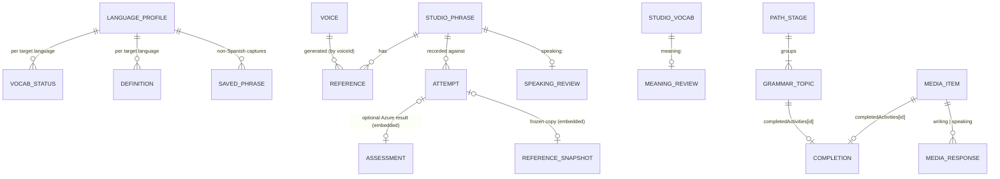

# Polybot Adaptive System — Repository Audit

**Phase:** 1 (Audit) · **Date:** 2026-10-15 · **Code changes made during audit:** none

This audit documents what Polybot is today, what learner data it already keeps, how (little) it personalizes, where the technical debt is, and how far it is from the closed-loop adaptive system described in the adaptive-learning specification. It ends with the architectural decisions that must be made before Phase 2 begins.

---

## 1. Executive summary

Polybot is a **local-first Manifest V3 Chrome extension** written in vanilla JavaScript. It has **no backend application server, no database, no user accounts, no generative-AI integration, and no event tracking**. All learner data lives in the browser (`chrome.storage.local` and `localStorage`) as JSON documents.

The specification assumes a conventional web application with a relational database. That assumption does not hold, so the adaptive system cannot be added as "a few new tables". Four foundational gaps sit on the critical path:

1. **No history, only current state.** Word status, review schedules, and activity completions are overwritten in place. Trends, retention, and improvement rates cannot be computed from the data Polybot keeps today. *An append-only learner event log is the prerequisite for everything else.*
2. **Almost no objective performance signal.** Grammar is self-marked complete, vocabulary cards are self-rated, media responses are free text. The only objective score is the optional Azure pronunciation assessment (Spanish, two locales). Spec metrics such as *accuracy rate* and events such as `answer_correct` have no source. *At least one auto-graded exercise type is required.*
3. **No analytical store and no path between the extension and one.** PostgreSQL 18 is installed locally but nothing connects to it. *We must decide how events leave the browser and how personalization decisions come back.*
4. **No learner identity.** There is one implicit learner per browser profile. *An install-scoped pseudonymous `learner_id` is needed, and multi-learner data for ML and BI will have to be synthetic and labeled as such.*

The codebase is in good health for its current scope: 88/88 tests pass, the static check passes, the data layer validates input rigorously, and the product copy is unusually honest ("No invented metrics", "flexible preferences, not learning styles"). Those strengths align with the spec's explainability principle and should be preserved.

---

## 2. Audit scope and method

| Item | Detail |
|---|---|
| Branch / commit | `main` @ `51c6b1b`, plus **uncommitted** working-tree changes across 30 files (the Gift of Tongues → Polybot rename, with legacy-key fallbacks and `tests/polybot-branding.test.cjs`) |
| Files read | Every runtime JS file, `manifest.json`, `package.json`, `server/`, `scripts/`, `tests/`, and the three existing docs (`learning-app-contracts.md`, `studio-contracts.md`, `verification.md`) |
| Baseline verification | `npm test` → **88 passed, 0 failed** (Node 24.19.0). `npm run check` → 36 JS files, MV3 metadata, and local assets pass |
| Local tooling found | Python 3.12 (scikit-learn, pandas, openpyxl, pytest installed; **psycopg and boto3 not installed**), Python 3.13 via `py`, **PostgreSQL 18.6 installed and running** as service `postgresql-x64-18` (`psql` is not on `PATH`; it is at `C:\Program Files\PostgreSQL\18\bin`). No Docker, no AWS CLI |

---

## 3. Current architecture

### 3.1 Summary table

| Concern | Current state |
|---|---|
| **Frontend framework** | None. Vanilla JS with HTML built from template strings (`studio.js`, `popup.js`, `catchup.js`, `personalization-*.js`). No build step, bundler, TypeScript, or linter |
| **Backend framework** | None for the product. Optional **local Node bridge** (`server/assessment-server.cjs`, built-in `node:http`, binds `127.0.0.1:17494`) proxies Azure pronunciation assessment so secrets stay out of the extension |
| **Database** | None. Browser key-value storage only: `chrome.storage.local` (with `unlimitedStorage`) for core data, `localStorage` for personalization preferences and theme |
| **Authentication** | None. No accounts or user IDs. One implicit learner per Chrome profile. The assessment bridge authenticates *callers* by exact `Origin` allow-list, not users |
| **AI integrations** | No generative AI or LLM. "AI lesson builder" is labeled *planned* (`aiLessonStatus: 'planned'`). Speech AI: optional **Azure Speech pronunciation assessment** (es-MX, es-ES); optional local **Voicebox** TTS app (`127.0.0.1:17493`); browser `speechSynthesis` |
| **External APIs** | Unofficial Google Translate endpoint (`translate.googleapis.com/translate_a/single?client=gtx`), Datamuse synonyms, YouTube caption tracks, institutional regional-speech recordings (`personalization-regions.js`) |
| **Internal APIs** | `chrome.runtime` message bus in `background.js:14-119` (11 message types: translation, capture, reader registration, transcript fetch). Data libraries exposed on `window` (`LearningData`, `StudioData`, `StudioAudio`, `SPTubeLang`, `Personalization*`) with CommonJS exports for tests |
| **Deployment** | "Load unpacked" in Chrome. No packaging, CI, or hosting. Local preview server (`scripts/preview.cjs`, `127.0.0.1:4173/4174`) swaps in `localStorage` |
| **State management** | Module-level mutable variables in `studio.js` (`state`, `learning`, `ui`, `p`). Full re-render via `innerHTML` after each mutation. Persistence layers serialize writes with a promise queue plus Web Locks (`study-data.js:422-426`, `learning-data.js:338-343`) |
| **Analytics / event tracking** | **None.** No telemetry, event log, or session tracking. The only time series is `vocabularyMasterySnapshots` (known/total word counts, `learning-data.js:394-424`) |
| **Learner / profile structures** | No learner model. Explicit preferences exist (method quiz, interests, region, accent, languages) but the UI says they *"do not yet change your lessons"* (`personalization-method.js:54`, `personalization-interests.js:36`) |

### 3.2 Runtime contexts

Key observation for the adaptive system: **there is no single write path.** Content scripts write vocabulary straight to storage (`shared.js:266-268`), the catch-up page bulk-writes (`catchup.js:63-66`), the studio writes through two different data libraries, and preferences go to a different storage API. Instrumenting events will require introducing a single emission point.

---

## 4. Current data model

### 4.1 Storage inventory

Polybot has no tables. It has storage keys holding JSON documents. Several documents are per-language (`_<lang>` suffix).

| Storage key | API | Owner / writers | Shape (abridged) | History kept? |
|---|---|---|---|---|
| `sptubeVocabulary_<lang>` | chrome.storage | `shared.js`, `catchup.js` | `{ [word]: 'learning' \| 'known' }` | **No.** No timestamps, overwritten |
| `sptubeDefinitions_<lang>` | chrome.storage | `shared.js` | `{ [word]: [{ translation, matched, sentence, savedAt, custom, ranges }] }` | `savedAt` per definition |
| `sptubePhrases_<lang>` (non-Spanish) | chrome.storage | `shared.js` | `[{ id, english, savedTranslation, source, videoClip, recording, savedAt }]` | `savedAt` |
| `sptubeTargetLang`, `sptubeNativeLang` | chrome.storage | `languages.js`, `learning-data.js` | language codes | No |
| `polybotStudio` (Spanish studio) | chrome.storage | `study-data.js` | `{ version, phrases[], voices[], attempts[], reviews{}, vocabulary[], settings{}, _meta{} }` | **Attempts: yes.** Reviews: latest state only |
| `polybotLearning` (language-neutral) | chrome.storage | `learning-data.js` | `{ version, mediaResponses[], completedActivities{id: ts}, targetLanguages[], vocabularyMasterySnapshots[] }` | Snapshots: yes. Completions: last timestamp only |
| `polybotMethod` | **localStorage** | `personalization-method.js` | `{ version, output: 0-100, grammar: 0-100, modalities[] }` | No |
| `polybotInterests` | **localStorage** | `personalization-interests.js` | `{ version, selected: [≤10 ids] }` | No |
| `polybotRegion` | **localStorage** | `personalization-regions.js` | `{ version, language, countryCode, name, locale, updatedAt }` | `updatedAt` only |
| `polybotTheme` | localStorage | `studio-theme.js` | `'light' \| 'dark' \| 'system'` | No |
| Legacy: `giftOfTongues*`, `spanishVocabulary`, `spanishPhrases`, `spanishDefinitions`, `voiceboxSettings`, `sptubeLegacyMigrationDone` | both | migration readers | older shapes | Read-only fallbacks |

### 4.2 Current entities and relationships

Relationships are enforced in code (`study-data.js:243-257` rejects attempts or reviews that reference missing phrases), not by a database.

### 4.3 Mapping to the entities the spec asks about

| Spec entity | Exists? | Where / notes |
|---|---|---|
| **users** | ❌ | No user record or ID. Implicit single learner |
| **learner_profiles** | ⚠️ Partial | Explicit preferences only (method, interests, region, accent, languages, theme), spread across two storage APIs |
| **languages** | ✅ (static) | `languages.js`: 26 languages with `speechLang`, `rtl`, `flag`. `CATCHUP_SUPPORTED = { es: true }` |
| **courses** | ⚠️ Implicit | One generic path per language: 5 CEFR stages A1–C1 (`learning-data.js:249-268`) |
| **lessons** | ❌ | No lesson entity. "Path stages" group grammar topics, but you cannot *take* a stage |
| **exercises** | ⚠️ Partial | 25 language-neutral grammar topics with a self-guided notice/transform/create routine (`learning-data.js:42-68`); vocab meaning/listening cards; shadowing; media responses. **None auto-graded** |
| **skills** | ⚠️ Implicit | Four UI areas (vocabulary, grammar, pronunciation, media) plus CEFR-tagged grammar topics (a usable subskill list). No skill entity or scores |
| **attempts** | ✅ Spanish speaking only | `polybotStudio.attempts[]`: `createdAt`, `duration`, `mode` (practice/test), `accentId`, `selfRating`, reference snapshot, optional assessment |
| **assessments** | ✅ Spanish speaking only | Embedded `AssessmentResult`: accuracy, fluency, completeness (0–100), per-word accuracy, `errorType`, phonemes. Requires the user's Azure setup |
| **AI interactions** | ❌ | No LLM. Translation requests are cached in service-worker memory only (`background.js:9`) |
| **progress tables** | ⚠️ Partial | `completedActivities` (last timestamp), `vocabularyMasterySnapshots` (counts over time), `reviews` (latest SRS state) |
| **user preference tables** | ⚠️ Partial | `polybotMethod`, `polybotInterests`, `polybotRegion`, `polybotStudio.settings`. Explicit only; no inferred preferences exist |
| **learner_events** | ❌ | — |
| **skill_scores, study_patterns, recommendations, personalization_decisions, model_predictions, pipeline_runs** | ❌ | — |

### 4.4 Learner-signal inventory

This table is the most important input for Phase 2. It records what learner behavior is captured today and how trustworthy each signal is.

| Behavior | Captured? | Signal type | Notes |
|---|---|---|---|
| Word marked learning/known (page, popup, catch-up) | Current state only | Self-report | Catch-up marks up to 10,000 words "known" in one click (`catchup.js:63`), so *known* ≠ demonstrated mastery |
| Word looked up / translated on a page | ❌ | — | Only an in-memory cache |
| Definition saved (with sentence context) | ✅ `savedAt` | Behavioral | Good "interest/difficulty" signal |
| Phrase captured from web/video | ✅ `savedAt`, `source`, `sourceUrl` | Behavioral | Source URLs are browsing data, so privacy-sensitive |
| Vocab meaning card rated (Spanish) | Latest SRS state only | Self-report | Previous ratings are overwritten (`study-data.js:542-561`) |
| Vocab meaning card rated (**non-Spanish**) | ❌ **discarded** | — | `studio.js:579-582` advances to the next word and saves nothing |
| Card revealed / time to reveal | ❌ | — | Would give a response-time signal |
| Pronunciation attempt | ✅ full history | Behavioral | Spanish only |
| Pronunciation assessment | ✅ | **Objective** | Spanish (es-MX, es-ES), explicit action, requires Azure |
| Timing comparison (pace, pauses) | Computed, not stored | Objective (timing only) | `study-audio.js:184-208`. Explicitly *not* a pronunciation score |
| Speaking self-rating | ✅ per attempt | Self-report | |
| Grammar topic marked complete | ✅ last timestamp | Self-report | Notes typed during practice are **not saved** (`studio.js:191`) |
| Media item completed | ✅ last timestamp | Self-report | |
| Media writing/speaking reflection | ✅ text | Free text | **Sensitive content**, so it should not flow into analytics |
| Sessions / time on task / navigation | ❌ | — | |
| Hints, skips, repeats, revisits | ❌ | — | No such interactions exist yet |
| Explicit preferences | ✅ | Explicit | Not read by any logic |

---

## 5. Current personalization

| Capability | Current behavior | Location |
|---|---|---|
| **Difficulty adjustment** | None. No difficulty attribute exists on any content | — |
| **Lesson sequencing** | Fixed CEFR order. "Up next" is the first incomplete path stage. Home "% complete" equals the share of grammar topics marked complete | `studio.js:136-141`, `learning-data.js:249-268` |
| **Spaced repetition** | SM-2-like intervals for Spanish *meaning* and *speaking* reviews: again = 10 min, hard ×1.2, good ×2.5, easy ×3.5 (min 4 d), capped at 365 d. Due items sorted by `dueAt` | `study-data.js:542-561`, `:623-628` |
| **Next-practice selection** | Pronunciation picks the first due speaking phrase (`studio.js:85`). Vocab practice cards step sequentially through words with meanings, not by due date | `studio.js:164`, `:580-582` |
| **AI prompt customization** | None (no LLM) | — |
| **Profile-based customization** | Region and accent choose reference voices. Theme and language choice. Method quiz, interests, and region are saved but **unused**, and the UI says so honestly | `personalization-*.js` |
| **Recommendation logic** | None beyond "first incomplete" and "first due" | — |
| **Placement** | Spanish frequency-band catch-up (top 10 / 100 / 1,000 / 10,000 words) bulk-marks words known | `catchup.js`, `frequency-data.js` |

Assessment: Polybot has **content-access personalization** (language, region, voice) and **one adaptive mechanism** (SRS for Spanish). It has no learner model and no decision layer. The explicit-preference capture UI is already built, which is a useful head start for the spec's "You told us" column.

---

## 6. Technical debt

Severity reflects impact on the adaptive-system work, not general code quality.

| # | Issue | Evidence | Severity | Why it matters for the adaptive system |
|---|---|---|---|---|
| T1 | **State overwritten, no history** | Vocab status map; `reviews[key] = result`; `completedActivities[id] = completedAt` | 🔴 High | Trend, retention, and improvement metrics are impossible without event history |
| T2 | **No single write path** | Content scripts and catch-up write storage directly; studio uses two libraries; preferences use `localStorage` | 🔴 High | Event emission would have to be duplicated in many places |
| T3 | **Lost-update race on vocabulary** | `shared.js:266-268` and `catchup.js:66` write the whole in-memory map without the locks `study-data.js` uses | 🟠 Medium | Two tabs can silently drop each other's word-status changes, corrupting the most common learner signal |
| T4 | **Non-Spanish card ratings discarded** | `studio.js:579-582` | 🟠 Medium | Throws away learner signal for 25 of 26 languages |
| T5 | **Split preference storage** | `polybotMethod` / `Interests` / `Region` in `localStorage` (studio origin only); not in backups (`learning-app-contracts.md`) | 🟠 Medium | Service worker and pipeline cannot read explicit preferences; preview and extension diverge |
| T6 | **Spanish-only studio store vs language-neutral learning store** | `study-data.js` hardcodes `_es` keys and accents; `learning-data.js` is language-neutral | 🟠 Medium | Skill scores must be per language; pronunciation data exists only for Spanish |
| T7 | **Duplicated logic** | `deriveVocabulary` in both `learning-data.js:215` and `study-data.js:273` (different status normalization); `safeTree`, `BAD_KEYS`, `browserStorage`, write queue, and the new legacy-key wrapper copied in both; `esc()` in 4+ files | 🟡 Low–Med | Two definitions of "a vocabulary item" will disagree in analytics |
| T8 | **Dead code and contract drift** | `renderToday`, `renderStats`, `renderReview`, `renderProgressOverview` (`studio.js:232-312`) are never called, and were already unused at HEAD. The contract says Home shows "cross-skill progress graphics", but they are not rendered | 🟡 Low–Med | The progress charts the dashboard could build on are currently invisible |
| T9 | **UI controller monolith** | `studio.js`: 110 KB, 846 lines, 18 lines over 1,000 characters; routing, rendering, business rules, and audio in one IIFE | 🟡 Low–Med | Personalization must live in its own module, not be added here |
| T10 | **Self-report conflated with mastery** | Catch-up bulk "known"; "Mark practice complete" | 🟡 Medium (data quality) | Mastery labels for ML need demonstrated performance, so self-report needs its own column |
| T11 | **Hardcoded configuration** | Ports 17493/17494, accent list, Azure locales, size limits, starter phrases, provided media, grammar topics all in code | 🟢 Low | Content metadata (difficulty, skill, topic) has nowhere to live |
| T12 | **Unofficial translation endpoint** | `background.js:261, 304, 322` (`client=gtx`) | 🟢 Low (here) | No SLA. Don't build analytics that depend on translation success |
| T13 | **Terminology conflicts with spec §3** | Section eyebrow "03 / LEARNING STYLE" and a "Visual" modality (`personalization-method.js:6, 54`) | 🟢 Low | The spec forbids learning-style labels; rename to "Content preferences" |
| T14 | **Repo hygiene** | 30 files uncommitted (rename); 6 stale prunable worktrees under `.worktrees/` pointing at an old path; empty untracked file `Language Learning App`; mixed `sptube` / `giftOfTongues` / `polybot` naming | 🟢 Low | Commit the rename first so Phase 2 starts from a clean baseline |
| T15 | **No lint/type checking; UI logic untested** | `verification.md`; tests cover data, audio, and server layers well, but not `studio.js` logic | 🟢 Low | Keep new personalization logic in pure, testable modules |

### Strengths to preserve

- **Defensive validation everywhere.** Prototype-pollution guards, size bounds, control-character checks, and atomic backup import (`study-data.js:45-59, 220-265`). This is the same mindset the spec's data-quality section asks for.
- **Write serialization** with Web Locks plus a local queue, and tests for concurrent writers.
- **Tombstones** prevent deleted records from being re-imported from legacy keys.
- **Honest product copy.** No seeded progress, no fabricated scores, explicit "planned" labels, "not a validated learning-style diagnosis".
- **Privacy posture.** Local-first. Cloud assessment only on explicit action. Secrets kept out of the extension.
- **Good data-layer test coverage** (88 tests), and a dependency-free toolchain.

---

## 7. Gap analysis against the specification

Size: **S** = days, **M** = about a week, **L** = multi-week for a learning-paced build.

| Spec § | Requirement | Current state | Gap | Size |
|---|---|---|---|---|
| 6 | Learner event system | None | Event schema, emission point, bounded local buffer, transport | **L** |
| 7 | Normalized relational schema + ERD | Browser JSON documents | Entire PostgreSQL schema, plus a content catalog (lessons, exercises, skills) that does not exist as data | **L** |
| 8 | Skill model | 4 implicit areas + 25 CEFR grammar topics | Skill entity, mapping of content and events to skills, per-language scores | M |
| 9 | Learner model; explicit vs inferred | Explicit preferences only, unused | Inferred attributes; schema-level explicit/inferred split | M |
| 10 | Confidence scores | — | value + confidence + evidence_count + updated_at for every inference | S |
| 11 | ETL pipeline + `pipeline_runs` | — | Python pipeline (validate → clean → transform → aggregate → load) | **L** |
| 12 | Data quality tracking | Strong *input* validation, no *pipeline* validation | Quarantine table, per-run counts, duplicate detection | M |
| 13 | Analytical SQL views | — | `vw_user_*` views | M |
| 14 | Key learner metrics | Only counts (attempts, minutes, days, known/total) | Most metrics need graded events and session data | M (after §6) |
| 15–16 | Rule-based personalization with reasons | "First incomplete" / "first due" | Dedicated engine, documented rules, reason strings, decision log | M |
| 17–18 | ML mastery prediction (scikit-learn) | — | Feature table, label definition, training pipeline. **Needs multi-learner data, so synthetic** | M |
| 19–24 | "How Polybot understands you" dashboard | Unused progress-chart code; personalization pages | New learner-facing view in the existing studio design language | M–L |
| 25 | `personalization_decisions` traceability | — | Table + UI explanation | S (after §15) |
| 26 | User overrides as explicit preferences | Preference UIs exist but drive nothing | Add override controls; precedence rule: explicit beats inferred | S–M |
| 27 | `DATA_PRIVACY.md` | Implicit in README / contracts | Document collection, inference, retention, controls | S |
| 28 | Tableau-ready export | — | Pseudonymized CSV + connection docs | S |
| 29 | Excel workbook | openpyxl available | Multi-tab workbook generator | S |
| 30 | AWS (S3 → Lambda → RDS) | — | AWS account, IAM user, CLI, boto3; S3 archive of event batches | M |
| 31 | Structured logging | User-facing toasts only | JSON logging in the pipeline, service, and AWS steps | S |
| 32 | Tests for validation, analytics, personalization, ML | 88 JS tests for existing layers | pytest suite for the Python side; Node tests for the event emitter | M |
| 33 | Frontend consistent with existing design | Mature design system in `studio.css` | Reuse `.card`, `.hub-*`, `.mastery-*`, light/dark, 390 px | — |

**Prerequisite not listed in the spec:** *gradable exercises.* The metrics in §14 (accuracy, difficulty success rate, hint usage) and the events in §6 (`answer_correct`, `hint_requested`) need exercises the system can grade. The cheapest high-value option is **auto-checked vocabulary recall** (multiple-choice or typed answers drawn from the learner's own saved words with saved meanings). It works for all 26 languages and reuses existing data.

---

## 8. Decisions required before Phase 2

These shape everything downstream. Recommendations are given; the project owner decides, and each confirmed decision will be recorded in `DECISIONS.md`.

> **Update 2026-10-15:** the owner accepted Option A for D1 and the recommendations for D2–D6. See [DECISIONS.md](DECISIONS.md), ADR-001 to ADR-006.

### D1 — How do events reach PostgreSQL, and how do decisions come back? *(most important)*

| Option | How it works | Pros | Cons |
|---|---|---|---|
| **A. Local Python "insights" service** *(recommended)* | Extension buffers events in `chrome.storage.local` and syncs batches to a local Python HTTP service on `127.0.0.1` (same opt-in, origin-checked pattern as the assessment bridge). The service runs the pipeline into PostgreSQL and serves the learner model and decisions back to the dashboard | Real closed loop; Python + SQL own the logic exactly as the spec intends; the same API contract can later be served from AWS; reuses a pattern the repo already has | Dashboard depends on a local service running (must degrade gracefully); adds a Python runtime |
| B. Export file → batch ETL | Extension exports an event file (like the existing backup); the Python pipeline loads it; results are re-imported | Simplest; fully offline; strong privacy story | Loop is manual, so this isn't really adaptive; personalization would lag |
| C. Rules in JS inside the extension; Python for offline BI/ML only | Personalization computed in the browser from the local event log | Instant; no service | Rule logic in JS, analytics in Python, so there are two sources of truth and less Python/SQL learning |
| D. Hosted cloud backend | API + RDS from day one | "Real" SaaS shape | Accounts, auth, hosting cost, and privacy work, which the spec warns against ("do not migrate everything just to claim cloud usage") |

### D2 — Learner identity
**Recommend:** generate a random install-scoped `learner_id` (UUID) in the extension. No accounts. BI exports use a further salted hash (`learner_key`).

### D3 — Where multi-learner data comes from
One real learner cannot train a classifier or populate a Tableau dashboard. **Recommend:** a documented **synthetic learner simulator** (Python) that generates plausible event streams. Rows carry `is_synthetic = true`, and every chart and model report states the data source. Real local events flow through the same pipeline.

### D4 — First gradable exercise
**Recommend:** auto-checked vocabulary recall (all languages, existing data). Grammar cloze exercises would need language-specific content the app deliberately does not invent today; defer them.

### D5 — Skill taxonomy v1
**Recommend:** `vocabulary`, `grammar`, `pronunciation`, `listening_comprehension`, `reading_comprehension`. Grammar subskills are the existing 25 topic slugs (already CEFR-tagged). Defer `speaking_fluency`, `writing_accuracy`, and `conversation` until a measurable source exists. Azure fluency is a candidate source for Spanish.

### D6 — Housekeeping before Phase 2
- Commit the Polybot rename so Phase 2 diffs are clean.
- Move explicit preferences from `localStorage` into `chrome.storage.local`, with migration, so the service worker can read them.
- Keep free-text media responses, phrase text, and source URLs **out** of analytics events. Use IDs, lengths, and counts instead.

---

## 9. What the project owner should understand before moving on

1. **Operational store vs. analytical store.** `chrome.storage.local` is Polybot's *operational* store: it holds what the app needs right now. PostgreSQL will be the *analytical* store: append-only facts plus derived tables. They answer different questions, and the analytical store is never the app's source of truth for, say, which phrases exist.
2. **Events are facts; state is a conclusion.** "Word *casa* is known" is a conclusion. "At 10:04 the learner answered *casa* correctly in 2.1 s without a hint" is a fact. You can rebuild any conclusion from facts, but not the other way around. Today Polybot keeps only conclusions.
3. **Self-report is a different signal from performance.** A "known" mark and a correct answer are both useful, but the schema should keep them in separate columns, never one blended score. The same applies to explicit vs. inferred preferences.
4. **Synthetic data is a legitimate tool if it is labeled.** It lets you build and test the pipeline, train a model, and design dashboards. It does *not* let you claim real-world model accuracy. Portfolio statements should say "trained and evaluated on simulated learner data".

---

## 10. Suggested phase mapping for this repository

| Spec phase | Adjusted scope here |
|---|---|
| 2 Data architecture | `EVENT_TAXONOMY.md`, `DATA_MODEL.md` + ERD, `ARCHITECTURE.md`, `DECISIONS.md` (D1–D6); PostgreSQL DDL |
| 3 Event tracking | Commit rename; single event emitter module (JS, tested); bounded local buffer; **vocabulary recall exercise** as the first graded source; fix T4 (non-Spanish ratings) |
| 4 Pipeline | Python package: validate → quarantine → load → transform; `pipeline_runs`; synthetic simulator |
| 5 Learner model | SQL views + Python aggregations; skill scores with confidence |
| 6 Rules | Python rule engine with documented rules and reason strings; `personalization_decisions` |
| 7 Dashboard | "How Polybot Understands You" view in the studio, revive the unused progress-chart code where it fits |
| 8 BI exports | Tableau CSV + Excel workbook from views |
| 9 ML | scikit-learn mastery model (LogReg, optional RF) on simulator + real features |
| 10 AWS | S3 archive of raw event batches (boto3), then optional Lambda/RDS |
