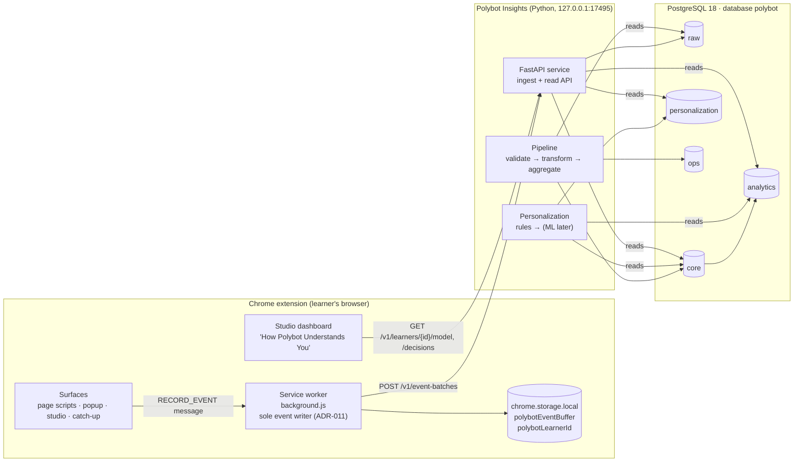
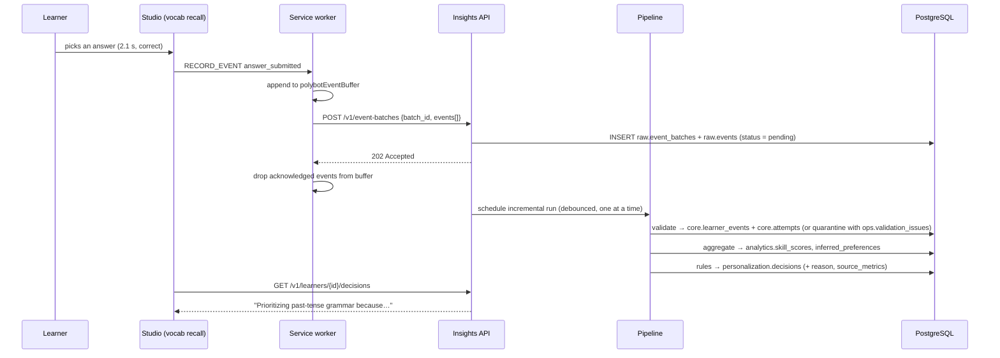

# Polybot Adaptive System — Architecture

How the closed loop in spec §1 maps onto real components. Decisions referenced as ADR-nnn are in [DECISIONS.md](DECISIONS.md). Current-state findings are in [ADAPTIVE_SYSTEM_AUDIT.md](ADAPTIVE_SYSTEM_AUDIT.md).

## 1. The loop, mapped to components

| Loop stage (spec §1) | Component | Where |
|---|---|---|
| User activity | Existing extension surfaces: page capture, popup, studio, catch-up | repo root (`*.js`) |
| Learner data | Event emitter → service-worker buffer → batch sync | `events.js` + `background.js` (Phase 3) |
| Validation + processing | Ingest API → `raw` → pipeline validate/transform → `core` | `insights/polybot_insights/` (Phases 3–4) |
| Performance analytics | SQL views and aggregates → `analytics` | `insights/.../db/migrations` (Phase 5) |
| Learner model | `analytics.skill_scores`, `learner_profiles`, `study_patterns`, `inferred_preferences` | Phase 5 |
| Personalization engine | Rule engine (later ML) → `personalization.decisions` | Phase 6 / Phase 9 |
| Personalized experience | Studio dashboard and recommendations read the service API | `studio.js` + new view module (Phase 7) |
| New activity → updated model | Recommendation and answer events flow back in | — |

## 2. Components



Each PostgreSQL schema has exactly one writer (ADR-007): the API writes `raw`; the pipeline writes `core`, `analytics`, and `ops`; personalization writes `personalization`.

## 3. A single answer, end to end



## 4. HTTP API (insights service)

| Method & path | Phase | Purpose |
|---|---|---|
| `GET /health` | 3 ✓ | Liveness plus database reachability (no learner data) |
| `POST /v1/event-batches` | 3 ✓ | Ingest ≤ 500 events / ≤ 1 MB. Idempotent by `batch_id` (`INSERT … ON CONFLICT DO NOTHING`): a repeated batch returns 200 with `duplicate_batch: true`; a new one 202. Unknown top-level fields → 422. A request whose `Origin` is not in `POLYBOT_ALLOWED_ORIGINS` is refused with 403 before any write (CORS alone would only hide the reply). No `Origin` (curl, simulator) is allowed: it is loopback-only |
| `POST /v1/pipeline-runs` | 4 ✓ | Process every pending raw event now (development and simulator use). Returns the run summary: status, row counts and issues by rule |
| `GET /v1/learners/{learner_id}/model?language=` | 5 | Skill scores, profile, study patterns, explicit and inferred preferences (with confidence labels) |
| `GET /v1/learners/{learner_id}/decisions?language=` | 6 | Active decisions with reason, adaptation text, source metrics, and recommendations |

Preference changes are **not** a separate write endpoint. They travel as `preference_set` events so every write follows the same path (ADR-011). The service worker flushes immediately after a preference event so overrides take effect within one pipeline run.

## 5. Local ports

| Port | Component | Status |
|---|---|---|
| 4173 / 4174 | Studio preview server (`scripts/preview.cjs`) | existing |
| 17493 | Voicebox (learner's own TTS app) | existing, external |
| 17494 | Assessment bridge (Node → Azure) | existing |
| **17495** | **Polybot Insights (Python)** | new |
| 5432 | PostgreSQL 18 (`postgresql-x64-18` service) | installed |

## 6. Trust boundaries and security

- **Loopback only.** The service binds `127.0.0.1` and never `0.0.0.0`.
- **Origin allow-list.** As in the assessment bridge, `ALLOWED_ORIGINS` must list the exact `chrome-extension://<id>` origin (and optionally the localhost preview). Wildcards are rejected.
- **Bounded input.** Body ≤ 1 MB, ≤ 500 events per batch, strict JSON parsing, unknown top-level fields rejected.
- **Pseudonymous identity.** The only identifier is a random `learner_id` (ADR-002). A local process that knows a learner's UUID could read their model. That is acceptable for a single-user local service and documented in DATA_PRIVACY.md.
- **Privacy guard at ingest.** Payload keys such as `text`, `url`, `sentence`, `transcript`, and `audio` are rejected as `PAYLOAD_FORBIDDEN_FIELD` ([EVENT_TAXONOMY.md §6](EVENT_TAXONOMY.md)).
- **Secrets.** Database credentials and the export salt live in `insights/.env` (git-ignored). Nothing secret is ever stored in the extension.

## 7. Failure modes and graceful degradation

| Situation | Behavior |
|---|---|
| Insights disabled (default) | Extension works exactly as today. Events are not recorded until the learner opts in |
| Service offline | Events accumulate in the bounded buffer (5,000 events). Sync retries with backoff. The dashboard shows "Polybot Insights isn't running" with setup help |
| Buffer full | Oldest events are dropped and `dropped_since_last_sync` is sent with the next batch. Never silent (spec §12) |
| Bad events | Stored in `raw.events` with status `invalid`, with reasons in `ops.validation_issues`. Never discarded |
| Pipeline failure | The run is marked `failed` with `error_summary`. Raw rows stay `pending` and are retried next run |
| Database unreachable | Ingest returns 503. The buffer holds events. `/health` reports the database as down |

## 8. Repository layout

```
/                       Chrome extension (Load unpacked here; no "_" names at this level, ADR-012)
├── *.js, *.html, *.css existing extension, plus (Phase 3):
│   ├── insights-events.js  event stamping on every surface + the service-worker hub (buffer, sessions, sync)
│   ├── vocab-writer.js     single writer of vocabulary maps in the service worker (ADR-019)
│   ├── prefs-store.js      personalization preferences in chrome.storage.local (ADR-021)
│   └── vocab-recall.js     Quick Recall question logic (ADR-004, ADR-017)
├── scripts/export-catalog.cjs  extension content → catalog JSON (ADR-015)
├── server/             existing Node assessment bridge
├── docs/               specification, decisions, architecture, data model, taxonomy
└── insights/           Python project (ADR-012)
    ├── pyproject.toml
    ├── .env.example
    ├── polybot_insights/
    │   ├── config.py               settings from the environment and insights/.env
    │   ├── catalog.py              loads the exported catalog into core.* (upsert, never delete)
    │   ├── ingest.py               the single write path into raw (used by the API and the simulator)
    │   ├── simulator.py            synthetic learners (ADR-003, ADR-023)
    │   ├── pipeline/               validate.py (19 rules, pure) · transform.py (core.*) · run.py (runs, ADR-022)
    │   ├── api/app.py              FastAPI service (python -m polybot_insights.api)
    │   └── db/
    │       ├── migrate.py          applies numbered SQL migrations, records them in ops.schema_migrations
    │       └── migrations/
    │           ├── 001_schemas_and_tables.sql
    │           └── 002_reference_data.sql
    └── tests/
        ├── conftest.py             temporary PostgreSQL cluster fixture (ADR-013)
        ├── test_schema.py          constraint and integrity tests
        ├── test_api.py             ingest API
        ├── test_catalog.py         catalog sync
        ├── test_client_contract.py the real JS emitter against the real API over HTTP
        ├── test_validate.py        every validation rule, no database
        ├── test_pipeline.py        runs end to end: accounting, duplicates, quarantine, facts, sessions
        └── test_simulator.py       simulated learners load cleanly; corrupted ones are quarantined
```

Later phases add `model/` (learner model), `personalization/`, `ml/` and `exports/` beside `pipeline/`.

## 9. Technology choices

| Concern | Choice | Why |
|---|---|---|
| Database | PostgreSQL 18 (local) | Already installed. Supports `NULLS NOT DISTINCT`, partial indexes, `jsonb`, and identity columns; an RDS migration path exists (spec §30) |
| DB driver | psycopg 3 | Current PostgreSQL driver; plain SQL, no ORM, so the SQL stays visible and learnable |
| Migrations | Numbered `.sql` files plus a small runner | Every schema change is reviewable SQL; no migration framework to learn first |
| API | FastAPI + uvicorn (Phase 3) | ADR-014 |
| ML | scikit-learn (installed) | Spec §17–18 |
| Exports | pandas + openpyxl (installed) | Spec §28–29 |
| AWS | boto3 → S3 (Phase 10) | Spec §30: S3 archive of raw batches first |
| Tests | pytest + temporary cluster | ADR-013 |

## 10. Cloud path (Phase 10, for orientation only)

Raw batches are archived to S3 (`raw.event_batches.archive_uri` already exists for this). Optionally, an S3 upload triggers a Lambda that runs the same validation module. RDS replaces local PostgreSQL only once the local loop is stable. The API contract in §4 does not change.
