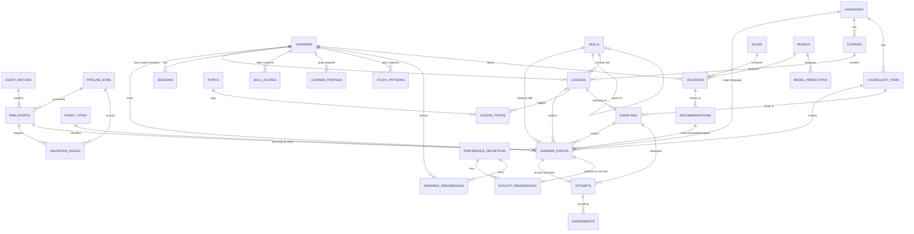

# Polybot Data Model — v1

The relational model behind the adaptive loop. The executable source of truth is [`001_schemas_and_tables.sql`](../insights/polybot_insights/db/migrations/001_schemas_and_tables.sql) plus [`002_reference_data.sql`](../insights/polybot_insights/db/migrations/002_reference_data.sql). This document explains them. Every constraint described here is exercised by `insights/tests/test_schema.py`.

## 1. Layers: one schema per writer (ADR-007)

```
raw  ──validate──▶  core  ──aggregate──▶  analytics  ──decide──▶  personalization
 ▲                   │                                               │
 ingest API          └────────── ops (runs, validation issues) ◀─────┘
```

| Schema | Written by | Contents | Analogy |
|---|---|---|---|
| `raw` | ingest API | `event_batches`, `events` (JSON exactly as received) | bronze / landing zone |
| `core` | pipeline | validated facts (`learner_events`, `attempts`, `assessments`, `sessions`, `explicit_preferences`) and dimensions (`learners`, `languages`, `skills`, `courses`, `lessons`, `exercises`, `vocabulary_items`, `topics`, catalogs) | silver / cleaned |
| `analytics` | pipeline | learner model (`skill_scores`, `learner_profiles`, `study_patterns`, `inferred_preferences`); `vw_*` views in Phase 5 | gold / derived |
| `personalization` | rule engine, ML | `rules`, `models`, `decisions`, `recommendations`, `model_predictions` | product output |
| `ops` | pipeline runner | `pipeline_runs`, `validation_issues`, `schema_migrations` | operations metadata |

## 2. Entity-relationship diagram



Every derived table also references `ops.pipeline_runs (run_id)`, so any number can be traced to the run that produced it. Those edges are omitted above for readability.

## 3. Table reference

**Grain** is what one row represents, which is the first question to answer about any table.

### raw
| Table | Grain | Key points |
|---|---|---|
| `raw.event_batches` | one sync request | PK `batch_id` (client UUID) makes retries idempotent. `dropped_since_last_sync` makes client-side loss visible |
| `raw.events` | one event as received | `body jsonb` is never edited. `status` ∈ pending/valid/invalid/duplicate; a processed row must name its `processed_run_id`. Invalid rows stay here forever (spec §12) |

### core — dimensions
| Table | Grain | Key points |
|---|---|---|
| `core.languages` | language | Synced from `languages.js` (ADR-015). Codes may carry a region (`zh-CN`), matching the extension |
| `core.learners` | install | Random UUID; no name or email exists anywhere. `is_synthetic` labels simulator data (ADR-003) |
| `core.skills` | skill or subskill | Self-referencing hierarchy. A CHECK forces `grammar.past-events` to sit under `grammar` |
| `core.courses` | course | One "My Path" per language (`path:es`) |
| `core.lessons` | content unit | Grammar topic, media item, shadowing phrase, or vocab practice set. `owner_learner_id` is set for learner-saved content (no text stored) |
| `core.topics`, `core.lesson_topics` | topic; lesson↔topic | One vocabulary for both learner interests and content tags, so "you chose cooking" can join to "lessons about cooking" |
| `core.vocabulary_items` | word per language | `vocab_item_id = language || ':' || term`, enforced by CHECK. Registered on first sight. `frequency_rank` and `difficulty_band` come from frequency data where it exists (Spanish today) |
| `core.exercises` | gradable item | `exercise_id = exercise_type || ':' || target`, enforced by CHECK. `is_graded` separates system-checked items from self-assessed ones |
| `core.event_types` | event type | The catalog from EVENT_TAXONOMY.md §3; a test keeps them identical |
| `core.preference_definitions` | preference key | Shared by explicit and inferred preferences; records whether each key can be stated, inferred, or both |

### core — facts
| Table | Grain | Key points |
|---|---|---|
| `core.learner_events` | one validated event | PK `event_id` deduplicates. `skill_id` and `difficulty_band` are resolved by the pipeline (ADR-010). A CHECK rejects events more than 5 minutes "from the future" |
| `core.sessions` | session | Derived from events; `active_seconds` cannot exceed wall-clock length |
| `core.attempts` | one answer or recording | **Objective performance only.** `is_correct` is present if and only if `is_graded`. Difficulty is copied as a point-in-time fact |
| `core.assessments` | one provider scoring | Accuracy, fluency, and completeness 0–100. `words_below_threshold ≤ words_scored`. Several per attempt allowed (reassessment) |
| `core.explicit_preferences` | learner × key × language | Current stated value; history is the `preference_set` events. `UNIQUE NULLS NOT DISTINCT` treats "all languages" (`NULL`) as one value |

### analytics — learner model
| Table | Grain | Key points |
|---|---|---|
| `analytics.skill_scores` | learner × language × skill × day | Daily snapshots, so the model's history is kept. `confidence` must be 0 when `evidence_count` is 0, and `mastery_score` needs evidence |
| `analytics.learner_profiles` | learner × language × day | Proficiency estimate, band, retention, consistency. Strengths and weaknesses are **not** stored; they are derived from `skill_scores` in a view so they cannot disagree |
| `analytics.study_patterns` | learner × day | Session length, frequency, response speed, rates. `preferred_hour_bucket` is allowed only with ≥ 5 sessions (spec §21) |
| `analytics.inferred_preferences` | learner × key × language | `confidence`, `evidence_count ≥ 1`, and a readable `rationale` are all NOT NULL |

### personalization
| Table | Grain | Key points |
|---|---|---|
| `personalization.rules` | rule version | Documented rule catalog (Phase 6) |
| `personalization.models` | model version | Training metrics, features, and `trained_on_synthetic` (Phase 9) |
| `personalization.decisions` | one decision | `reason` and `adaptation` text required; `source_metrics` must be a non-empty object; must reference a rule or a model. A partial unique index allows only **one active decision per learner, language, and type** |
| `personalization.recommendations` | one suggested item | Outcome (accepted/skipped/expired) must have a timestamp, and nothing can be accepted before it was shown |
| `personalization.model_predictions` | one prediction | Probability plus a feature snapshot for explainability |

### ops
| Table | Grain | Key points |
|---|---|---|
| `ops.pipeline_runs` | pipeline execution | Finished runs must satisfy `rows_processed = valid + invalid + duplicate`. Failed runs must say why |
| `ops.validation_issues` | one rule violation | Rule code, severity, field. The message never copies learner content |
| `ops.schema_migrations` | applied migration | Filename + checksum. Editing an applied migration is detected |

## 4. Spec entity mapping (spec §7)

| Spec entity | Table(s) | Note |
|---|---|---|
| users | `core.learners` | "Learner", because there are no accounts (ADR-002) |
| learner_profiles | `analytics.learner_profiles` | System-generated, so it lives in `analytics` |
| languages, courses, lessons, exercises, skills | `core.*` same names | |
| attempts, assessments | `core.attempts`, `core.assessments` | |
| learner_events | `core.learner_events` (+ `raw.events`) | |
| skill_scores, study_patterns | `analytics.*` same names | |
| learning_preferences, content_preferences | `core.explicit_preferences` + `analytics.inferred_preferences`, keyed by `core.preference_definitions.category` | Split by **source** (spec §9) rather than by category; category is a column |
| recommendations, model_predictions | `personalization.*` same names | |
| personalization_decisions | `personalization.decisions` | Fields from spec §25 plus `adaptation`, `status`, rule/model reference |
| pipeline_runs | `ops.pipeline_runs` | Spec §11 + §12 counters |

## 5. Design choices worth understanding

1. **Constraints are a backstop, not the validator.** The pipeline rejects bad events with a reason (`ops.validation_issues`). The database constraints guarantee that even a pipeline bug cannot write an impossible row. Both are needed: constraints say *no*, the pipeline says *why*.
2. **Domains** (`core.ratio`, `core.difficulty_band`, `core.content_id`) write a rule once and reuse it in many columns.
3. **Point-in-time copies are not denormalization mistakes.** `attempts.difficulty_band` and `attempts.skill_id` record what was true when the learner answered, even if the catalog changes later.
4. **Snapshots over overwrites.** `skill_scores`, `learner_profiles`, and `study_patterns` keep one row per day. That is what lets the dashboard show progress over time, the thing the extension's current storage cannot do (audit T1).
5. **Derived, not stored.** Strengths, weaknesses, accuracy rates, and revisit rates come from views (Phase 5) over facts, so two copies can never disagree.
6. **`NULL` means "unknown", never zero.** `mastery_score` is `NULL` without objective evidence. A learner with no grammar attempts has an *unknown* grammar mastery, not a mastery of 0.
7. **Foreign keys are not indexed automatically.** PostgreSQL indexes primary keys and unique constraints only. Indexes on FK columns are added deliberately where queries need them (§6).

### 5.1 Phase 3 corrections to migration 001 (before its first real apply)

Loading the real catalog exposed two constraints that could never have passed with real data. Both were fixed in place, which was still safe because 001 had only ever run on throwaway test clusters; each fix has a test.

- `core.languages.language_code` allowed only `^[a-z]{2,3}$`, but the extension's Chinese is `zh-CN`. Every Chinese event would have failed as `UNKNOWN_LANGUAGE`. Now `^[a-z]{2,3}(-[A-Z]{2})?$`.
- `core.content_id` used the regex `{1,300}`; PostgreSQL limits repetition counts to 255, so *every* lesson ID raised "invalid repetition count". The length is now a separate `length(VALUE) <= 300` check.

From the first `python -m polybot_insights.db.migrate` against the real database onward, schema changes go in new numbered files only.

## 6. Indexes

| Table | Index | Serves |
|---|---|---|
| `raw.events` | partial `(raw_event_id) WHERE status = 'pending'` | the pipeline's "what's new?" scan stays small however large `raw` grows |
| `core.attempts` | `(learner_id, skill_id, attempted_at DESC)` | per-skill accuracy and trend |
| `core.sessions` | `(learner_id, started_at DESC)` | study patterns |
| `personalization.decisions` | unique partial `(learner_id, language_code, decision_type) NULLS NOT DISTINCT WHERE status = 'active'` | one active decision per type; dashboard lookup |
| `core.learner_events` | `learner_events_timeline (learner_id, occurred_at DESC, skill_id)` | Q1 timeline and Q2 skill evidence (§6.1) |
| `core.learner_events` | `learner_events_type_time (event_type, occurred_at)` | Q3 BI by type, index-only |
| `core.learner_events` | partial `learner_events_recommendation (recommendation_id) WHERE recommendation_id IS NOT NULL` | Q4 recommendation outcomes |

### 6.1 How the `core.learner_events` indexes were chosen

**Access patterns**

| | Query | Used by |
|---|---|---|
| Q1 | `WHERE learner_id = $1 ORDER BY occurred_at DESC LIMIT 200` | dashboard timeline, session building |
| Q2 | `WHERE learner_id = $1 AND skill_id = $2 AND occurred_at >= now() - interval '28 days'` | skill evidence for scores and "why" explanations |
| Q3 | `WHERE event_type = $1 AND occurred_at >= $2` (grouped by day) | daily aggregates, BI exports |
| Q4 | `WHERE recommendation_id = $1` (≈ 1% of rows non-NULL) | recommendation outcomes |

**Measurements.** `EXPLAIN (ANALYZE, BUFFERS)` on 500,000 synthetic events (500 learners × 1,000 events over 180 days, inserted in time order so each learner's rows are scattered like real data; heap 89 MB). The test learner has 1,000 events, 14 matching Q2; Q3 matches 3,595 rows. A *buffer* is an 8 kB page read from cache or disk, the most reliable cost measure here. Timings are single warm runs.

| Query | No extra indexes | Chosen 3 indexes | Plan with chosen indexes |
|---|---|---|---|
| Q1 | 44.8 ms · 11,450 buffers · seq scan + sort | **0.05 ms · 86 buffers** · no sort | Index Scan using `learner_events_timeline` |
| Q2 | 45.8 ms · 11,374 buffers · seq scan | **0.03 ms · 12 buffers** | Index Scan using `learner_events_timeline` |
| Q3 | 46.9 ms · 11,450 buffers · seq scan + sort | **0.8 ms · 25 buffers** · 0 heap fetches | Index Only Scan using `learner_events_type_time` |
| Q4 | 50.2 ms · 11,374 buffers · seq scan | **0.01 ms · 4 buffers** | Index Scan using `learner_events_recommendation` |

**Alternatives measured and rejected**

| Alternative | Benefit | Cost | Verdict |
|---|---|---|---|
| Add a dedicated Q2 index `(learner_id, skill_id, occurred_at DESC)` | Q2: 12 → 11 buffers | +30 MB; 50k inserts ≈ 2.17 s → 2.28 s | Rejected: one buffer is not worth a whole index |
| Full (non-partial) Q4 index | none (4 → 5 buffers) | 3.4 MB instead of 88 kB; indexes 99% NULLs | Rejected |

Insert cost overall: 50,000 inserts took ≈ 2.05 s with only the PK and unique indexes, versus ≈ 2.17 s with the three chosen indexes (single runs, so treat this as indicative only).

**Why each design works**
- **Column order: equality first, then range or ordering.** In Q1 the learner is an exact match and the time column provides the order, so PostgreSQL reads the newest 200 entries directly and never sorts. Putting `skill_id` second would break this: entries would be grouped by skill, so the newest events across all skills would no longer sit together.
- **One index serving two queries.** With `skill_id` as the *third* key column, Q2 scans the learner's last 28 days in the index (about 155 entries) and checks `skill_id` inside the index, so only the 14 matching rows touch the table. That gets within one buffer of a dedicated index.
- **Index-only scans and the visibility map.** Q3 reads only `event_type` and `occurred_at`, both in the index, so PostgreSQL can skip the table entirely, but only for pages the visibility map marks all-visible. An early run showed 1,125 heap fetches because the benchmark's own rolled-back inserts had dirtied the newest pages, exactly the "last 30 days" region. After `VACUUM` the count was 0. In production, autovacuum maintains the visibility map, and the most recent pages are always the least likely to be all-visible.
- **Partial indexes for sparse columns.** `recommendation_id = $1` implies `recommendation_id IS NOT NULL`, so the planner can use an index that stores only the 1% of rows that matter.
- **Not indexed:** `run_id`, `lesson_id`, `exercise_id`, `vocab_item_id`, `decision_id`. No access pattern filters on them, and the rows they reference are never deleted, so FK checks never search this table for them. The timeline index also covers the FK check when a learner's data is deleted.

**Locked in by tests.** `test_learner_events_has_exactly_the_designed_indexes` checks the exact index set. `test_each_access_pattern_can_use_its_index` runs `EXPLAIN` with sequential scans disabled and asserts each query finds its index, and that Q1 needs no sort. Both were confirmed to fail when the Q4 index is removed.

**Re-run on a real database (psql):**

```sql
EXPLAIN (ANALYZE, BUFFERS)
SELECT * FROM core.learner_events
WHERE learner_id = '<a learner uuid>' ORDER BY occurred_at DESC LIMIT 200;
```

## 7. Retention (initial position; DATA_PRIVACY.md will finalize)

- `raw.events`: keep 180 days locally, then archive to S3 (Phase 10) and delete locally.
- `core` facts: kept while the learner keeps Insights enabled. Disabling Insights offers deletion of all rows for that `learner_id`.
- `analytics` snapshots: daily rows older than 1 year may be thinned to weekly.
- `ops`: run summaries kept indefinitely; `validation_issues` 180 days.
